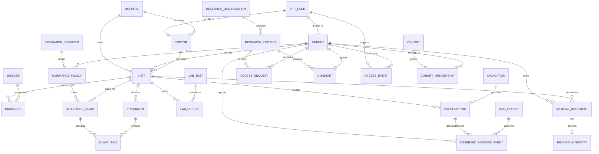

# MedChain Entity-Relationship & Data Model Specification

## 1. Relational Entity-Relationship Diagram (PostgreSQL)



---

## 2. PostgreSQL Table Specifications

### 2.1 Identity and Organizations
1. **`app_user`**
   - `id`: `UUID PRIMARY KEY`
   - `email`: `VARCHAR(255) UNIQUE NOT NULL`
   - `password_hash`: `VARCHAR(255) NOT NULL`
   - `role`: `VARCHAR(50) NOT NULL` (CHECK `role IN ('patient', 'doctor', 'researcher', 'insurance_analyst', 'admin')`)
   - `is_active`: `BOOLEAN NOT NULL DEFAULT TRUE`
   - `created_at`: `TIMESTAMPTZ NOT NULL DEFAULT NOW()`
   - `updated_at`: `TIMESTAMPTZ NOT NULL DEFAULT NOW()`

2. **`patient`**
   - `id`: `UUID PRIMARY KEY`
   - `user_id`: `UUID UNIQUE REFERENCES app_user(id) ON DELETE SET NULL`
   - `display_code`: `VARCHAR(50) UNIQUE NOT NULL` (e.g., `PT-100234`)
   - `date_of_birth`: `DATE NOT NULL`
   - `sex`: `VARCHAR(20) NOT NULL` (CHECK `sex IN ('M', 'F', 'O')`)
   - `created_at`: `TIMESTAMPTZ NOT NULL DEFAULT NOW()`

3. **`doctor`**
   - `id`: `UUID PRIMARY KEY`
   - `user_id`: `UUID UNIQUE REFERENCES app_user(id) ON DELETE CASCADE`
   - `hospital_id`: `UUID NOT NULL REFERENCES hospital(id)`
   - `display_name`: `VARCHAR(100) NOT NULL`
   - `specialty`: `VARCHAR(100) NOT NULL`

4. **`hospital`**
   - `id`: `UUID PRIMARY KEY`
   - `name`: `VARCHAR(150) NOT NULL`
   - `region`: `VARCHAR(100) NOT NULL`

5. **`research_organization`**
   - `id`: `UUID PRIMARY KEY`
   - `name`: `VARCHAR(150) NOT NULL`
   - `organization_type`: `VARCHAR(100) NOT NULL`

6. **`research_project`**
   - `id`: `UUID PRIMARY KEY`
   - `organization_id`: `UUID NOT NULL REFERENCES research_organization(id)`
   - `title`: `VARCHAR(200) NOT NULL`
   - `purpose`: `TEXT NOT NULL`
   - `status`: `VARCHAR(50) NOT NULL DEFAULT 'ACTIVE'`
   - `created_by`: `UUID NOT NULL REFERENCES app_user(id)`
   - `created_at`: `TIMESTAMPTZ NOT NULL DEFAULT NOW()`

---

### 2.2 Clinical Encounters & Reference Data
7. **`visit`**
   - `id`: `UUID PRIMARY KEY`
   - `patient_id`: `UUID NOT NULL REFERENCES patient(id)`
   - `doctor_id`: `UUID NOT NULL REFERENCES doctor(id)`
   - `hospital_id`: `UUID NOT NULL REFERENCES hospital(id)`
   - `visit_at`: `TIMESTAMPTZ NOT NULL`
   - `visit_type`: `VARCHAR(50) NOT NULL`
   - `summary_code`: `VARCHAR(50)`

8. **`disease`**
   - `id`: `UUID PRIMARY KEY`
   - `code`: `VARCHAR(50) UNIQUE NOT NULL` (e.g. ICD-10 `E11.9`)
   - `name`: `VARCHAR(150) NOT NULL`
   - `description`: `TEXT`

9. **`diagnosis`**
   - `id`: `UUID PRIMARY KEY`
   - `visit_id`: `UUID NOT NULL REFERENCES visit(id)`
   - `disease_id`: `UUID NOT NULL REFERENCES disease(id)`
   - `diagnosed_at`: `TIMESTAMPTZ NOT NULL DEFAULT NOW()`
   - `severity`: `VARCHAR(50) NOT NULL` (CHECK `severity IN ('Mild', 'Moderate', 'Severe', 'Critical')`)
   - `status`: `VARCHAR(50) NOT NULL DEFAULT 'Active'`
   - `notes_reference`: `VARCHAR(100)`

10. **`medication`**
    - `id`: `UUID PRIMARY KEY`
    - `code`: `VARCHAR(50) UNIQUE NOT NULL` (e.g. RxNorm `860975`)
    - `name`: `VARCHAR(150) NOT NULL`
    - `generic_name`: `VARCHAR(150) NOT NULL`
    - `drug_class`: `VARCHAR(100) NOT NULL`

11. **`prescription`**
    - `id`: `UUID PRIMARY KEY`
    - `visit_id`: `UUID NOT NULL REFERENCES visit(id)`
    - `medication_id`: `UUID NOT NULL REFERENCES medication(id)`
    - `start_date`: `DATE NOT NULL`
    - `end_date`: `DATE`
    - `dose_text`: `VARCHAR(100) NOT NULL`
    - `frequency_text`: `VARCHAR(100) NOT NULL`
    - `prescribed_by`: `UUID NOT NULL REFERENCES doctor(id)`
    - Constraint: `CHECK (end_date IS NULL OR end_date >= start_date)`

12. **`treatment`**
    - `id`: `UUID PRIMARY KEY`
    - `visit_id`: `UUID NOT NULL REFERENCES visit(id)`
    - `treatment_type`: `VARCHAR(100) NOT NULL`
    - `description_code`: `VARCHAR(100) NOT NULL`
    - `start_date`: `DATE NOT NULL`
    - `end_date`: `DATE`
    - `outcome_status`: `VARCHAR(50) NOT NULL`
    - Constraint: `CHECK (end_date IS NULL OR end_date >= start_date)`

13. **`lab_test`**
    - `id`: `UUID PRIMARY KEY`
    - `code`: `VARCHAR(50) UNIQUE NOT NULL` (e.g. LOINC `2345-7`)
    - `name`: `VARCHAR(150) NOT NULL`
    - `unit`: `VARCHAR(50) NOT NULL`
    - `reference_range_text`: `VARCHAR(100) NOT NULL`

14. **`lab_result`**
    - `id`: `UUID PRIMARY KEY`
    - `visit_id`: `UUID NOT NULL REFERENCES visit(id)`
    - `lab_test_id`: `UUID NOT NULL REFERENCES lab_test(id)`
    - `result_value`: `NUMERIC(10, 3) NOT NULL`
    - `result_text`: `VARCHAR(200)`
    - `measured_at`: `TIMESTAMPTZ NOT NULL DEFAULT NOW()`
    - `is_abnormal`: `BOOLEAN NOT NULL DEFAULT FALSE`

15. **`side_effect`**
    - `id`: `UUID PRIMARY KEY`
    - `code`: `VARCHAR(50) UNIQUE NOT NULL` (e.g. MedDRA `10028813`)
    - `name`: `VARCHAR(150) NOT NULL`
    - `description`: `TEXT`

16. **`observed_adverse_event`**
    - `id`: `UUID PRIMARY KEY`
    - `patient_id`: `UUID NOT NULL REFERENCES patient(id)`
    - `prescription_id`: `UUID REFERENCES prescription(id)`
    - `side_effect_id`: `UUID NOT NULL REFERENCES side_effect(id)`
    - `reported_at`: `TIMESTAMPTZ NOT NULL DEFAULT NOW()`
    - `severity`: `VARCHAR(50) NOT NULL`
    - `outcome`: `VARCHAR(100) NOT NULL`
    - `evidence_quality`: `VARCHAR(50) NOT NULL DEFAULT 'OBSERVED_ASSOCIATION'`

---

### 2.3 Documents & Integrity
17. **`medical_document`**
    - `id`: `UUID PRIMARY KEY`
    - `patient_id`: `UUID NOT NULL REFERENCES patient(id)`
    - `visit_id`: `UUID REFERENCES visit(id)`
    - `document_type`: `VARCHAR(50) NOT NULL`
    - `mongo_document_id`: `VARCHAR(100) NOT NULL`
    - `storage_status`: `VARCHAR(50) NOT NULL DEFAULT 'STORED'`
    - `created_at`: `TIMESTAMPTZ NOT NULL DEFAULT NOW()`
    - `created_by`: `UUID NOT NULL REFERENCES app_user(id)`

18. **`record_integrity`**
    - `id`: `UUID PRIMARY KEY`
    - `medical_document_id`: `UUID UNIQUE NOT NULL REFERENCES medical_document(id) ON DELETE CASCADE`
    - `record_version`: `INTEGER NOT NULL DEFAULT 1`
    - `commitment_hash`: `VARCHAR(66) NOT NULL` (0x prefixed 64-char hex)
    - `algorithm`: `VARCHAR(50) NOT NULL DEFAULT 'SHA256_SALTED'`
    - `verified_at`: `TIMESTAMPTZ`
    - `verification_status`: `VARCHAR(50) NOT NULL DEFAULT 'UNVERIFIED'`

---

### 2.4 Insurance Domain
19. **`insurance_provider`**
    - `id`: `UUID PRIMARY KEY`
    - `name`: `VARCHAR(150) NOT NULL`
    - `provider_code`: `VARCHAR(50) UNIQUE NOT NULL`

20. **`insurance_policy`**
    - `id`: `UUID PRIMARY KEY`
    - `patient_id`: `UUID NOT NULL REFERENCES patient(id)`
    - `provider_id`: `UUID NOT NULL REFERENCES insurance_provider(id)`
    - `policy_reference`: `VARCHAR(100) UNIQUE NOT NULL`
    - `coverage_type`: `VARCHAR(100) NOT NULL`
    - `valid_from`: `DATE NOT NULL`
    - `valid_until`: `DATE NOT NULL`
    - `status`: `VARCHAR(50) NOT NULL DEFAULT 'ACTIVE'`
    - Constraint: `CHECK (valid_until >= valid_from)`

21. **`insurance_claim`**
    - `id`: `UUID PRIMARY KEY`
    - `policy_id`: `UUID NOT NULL REFERENCES insurance_policy(id)`
    - `visit_id`: `UUID NOT NULL REFERENCES visit(id)`
    - `submitted_at`: `TIMESTAMPTZ NOT NULL DEFAULT NOW()`
    - `claimed_amount`: `NUMERIC(12, 2) NOT NULL CHECK (claimed_amount >= 0)`
    - `approved_amount`: `NUMERIC(12, 2) NOT NULL DEFAULT 0 CHECK (approved_amount >= 0)`
    - `status`: `VARCHAR(50) NOT NULL DEFAULT 'SUBMITTED'`
    - `review_flag`: `BOOLEAN NOT NULL DEFAULT FALSE`
    - `review_reason`: `TEXT`

22. **`claim_item`**
    - `id`: `UUID PRIMARY KEY`
    - `claim_id`: `UUID NOT NULL REFERENCES insurance_claim(id) ON DELETE CASCADE`
    - `treatment_id`: `UUID REFERENCES treatment(id)`
    - `item_code`: `VARCHAR(50) NOT NULL`
    - `description`: `VARCHAR(200) NOT NULL`
    - `quantity`: `INTEGER NOT NULL CHECK (quantity > 0)`
    - `unit_cost`: `NUMERIC(12, 2) NOT NULL CHECK (unit_cost >= 0)`
    - `line_amount`: `NUMERIC(12, 2) NOT NULL CHECK (line_amount >= 0)`

---

### 2.5 Consent, Access & Audit
23. **`consent`**
    - `id`: `UUID PRIMARY KEY`
    - `patient_id`: `UUID NOT NULL REFERENCES patient(id)`
    - `requester_project_id`: `UUID NOT NULL REFERENCES research_project(id)`
    - `purpose`: `TEXT NOT NULL`
    - `scope_json`: `JSONB NOT NULL`
    - `access_mode`: `VARCHAR(50) NOT NULL DEFAULT 'DE_IDENTIFIED'`
    - `valid_from`: `TIMESTAMPTZ NOT NULL`
    - `valid_until`: `TIMESTAMPTZ NOT NULL`
    - `status`: `VARCHAR(50) NOT NULL DEFAULT 'GRANTED'`
    - `granted_at`: `TIMESTAMPTZ NOT NULL DEFAULT NOW()`
    - `revoked_at`: `TIMESTAMPTZ`
    - `chain_tx_hash`: `VARCHAR(66)`
    - Constraint: `CHECK (valid_until > valid_from)`

24. **`access_request`**
    - `id`: `UUID PRIMARY KEY`
    - `patient_id`: `UUID NOT NULL REFERENCES patient(id)`
    - `requester_project_id`: `UUID NOT NULL REFERENCES research_project(id)`
    - `requested_scope_json`: `JSONB NOT NULL`
    - `purpose`: `TEXT NOT NULL`
    - `status`: `VARCHAR(50) NOT NULL DEFAULT 'PENDING'` (CHECK `status IN ('PENDING', 'APPROVED', 'REJECTED')`)
    - `requested_at`: `TIMESTAMPTZ NOT NULL DEFAULT NOW()`
    - `decided_at`: `TIMESTAMPTZ`

25. **`access_event`**
    - `id`: `UUID PRIMARY KEY`
    - `actor_user_id`: `UUID NOT NULL REFERENCES app_user(id)`
    - `patient_id`: `UUID REFERENCES patient(id)`
    - `resource_type`: `VARCHAR(100) NOT NULL`
    - `resource_reference`: `VARCHAR(150) NOT NULL`
    - `action`: `VARCHAR(50) NOT NULL`
    - `decision`: `VARCHAR(20) NOT NULL` (CHECK `decision IN ('GRANTED', 'DENIED')`)
    - `reason_code`: `VARCHAR(100) NOT NULL`
    - `occurred_at`: `TIMESTAMPTZ NOT NULL DEFAULT NOW()`
    - `request_id`: `VARCHAR(100)`
    - `chain_tx_hash`: `VARCHAR(66)`

26. **`blockchain_event`**
    - `id`: `UUID PRIMARY KEY`
    - `event_type`: `VARCHAR(100) NOT NULL`
    - `opaque_reference`: `VARCHAR(100) NOT NULL`
    - `commitment_hash`: `VARCHAR(66) NOT NULL`
    - `transaction_hash`: `VARCHAR(66)`
    - `block_number`: `BIGINT`
    - `status`: `VARCHAR(50) NOT NULL DEFAULT 'PENDING'` (CHECK `status IN ('PENDING', 'CONFIRMED', 'FAILED', 'UNANCHORED')`)
    - `created_at`: `TIMESTAMPTZ NOT NULL DEFAULT NOW()`

27. **`outbox_event`**
    - `id`: `UUID PRIMARY KEY`
    - `event_type`: `VARCHAR(100) NOT NULL`
    - `aggregate_id`: `VARCHAR(100) NOT NULL`
    - `payload_json`: `JSONB NOT NULL`
    - `status`: `VARCHAR(50) NOT NULL DEFAULT 'PENDING'`
    - `attempt_count`: `INTEGER NOT NULL DEFAULT 0`
    - `created_at`: `TIMESTAMPTZ NOT NULL DEFAULT NOW()`
    - `processed_at`: `TIMESTAMPTZ`

---

### 2.6 Cohort Analytics
28. **`cohort`**
    - `id`: `UUID PRIMARY KEY`
    - `name`: `VARCHAR(150) NOT NULL`
    - `description`: `TEXT`
    - `created_by`: `UUID NOT NULL REFERENCES app_user(id)`
    - `feature_definition_json`: `JSONB NOT NULL`
    - `algorithm`: `VARCHAR(50) NOT NULL DEFAULT 'K-Means'`
    - `created_at`: `TIMESTAMPTZ NOT NULL DEFAULT NOW()`

29. **`cohort_membership`**
    - `id`: `UUID PRIMARY KEY`
    - `cohort_id`: `UUID NOT NULL REFERENCES cohort(id) ON DELETE CASCADE`
    - `patient_id`: `UUID NOT NULL REFERENCES patient(id)`
    - `cluster_label`: `INTEGER NOT NULL`
    - `run_id`: `UUID NOT NULL`
    - `created_at`: `TIMESTAMPTZ NOT NULL DEFAULT NOW()`

30. **`analytics_run`**
    - `id`: `UUID PRIMARY KEY`
    - `run_type`: `VARCHAR(50) NOT NULL`
    - `parameters_json`: `JSONB NOT NULL`
    - `status`: `VARCHAR(50) NOT NULL DEFAULT 'COMPLETED'`
    - `started_at`: `TIMESTAMPTZ NOT NULL DEFAULT NOW()`
    - `completed_at`: `TIMESTAMPTZ`
    - `summary_json`: `JSONB NOT NULL`

---

## 3. MongoDB Document Collection: `medical_documents`

```json
{
  "_id": "uuid-string",
  "patient_id": "patient-uuid-string",
  "visit_id": "visit-uuid-string-or-null",
  "document_type": "clinical_note | diagnostic_report",
  "title": "Synthetic follow-up note",
  "content": "Patient presents with controlled blood glucose...",
  "structured_extract": {
    "vitals": {"bp": "120/80", "heart_rate": 72},
    "assessment": "Type 2 Diabetes Mellitus stable"
  },
  "created_at": "2026-10-14T10:00:00Z",
  "created_by": "user-uuid-string",
  "version": 1
}
```
Indexes:
- `{"patient_id": 1}`
- `{"visit_id": 1}`
- `{"document_type": 1}`
- `{"created_at": -1}`

---

## 4. Neo4j Graph Model

### 4.1 Node Labels
- `:Patient {id: STRING, display_code: STRING}`
- `:Disease {code: STRING, name: STRING}`
- `:Medication {code: STRING, name: STRING, drug_class: STRING}`
- `:SideEffect {code: STRING, name: STRING}`
- `:Cohort {id: STRING, name: STRING}`

### 4.2 Relationships
- `(:Patient)-[:HAS_DIAGNOSIS {diagnosed_at: STRING, severity: STRING}]->(:Disease)`
- `(:Patient)-[:RECEIVED {start_date: STRING, dose: STRING}]->(:Medication)`
- `(:Medication)-[:OBSERVED_WITH {evidence_quality: STRING, reported_count: INTEGER}]->(:SideEffect)`
- `(:Disease)-[:CO_OCCURS_WITH {patient_count: INTEGER}]->(:Disease)`
- `(:Patient)-[:MEMBER_OF {cluster_label: INTEGER}]->(:Cohort)`
